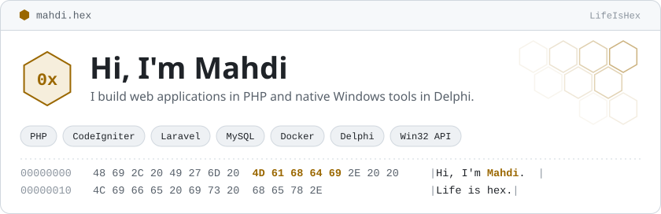
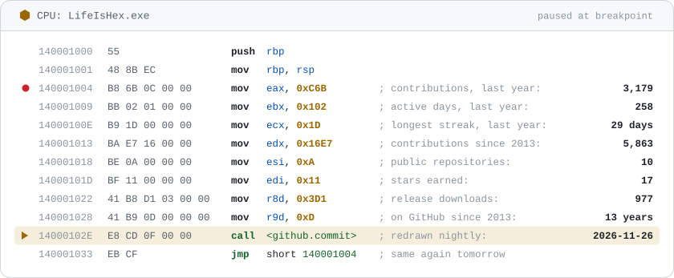
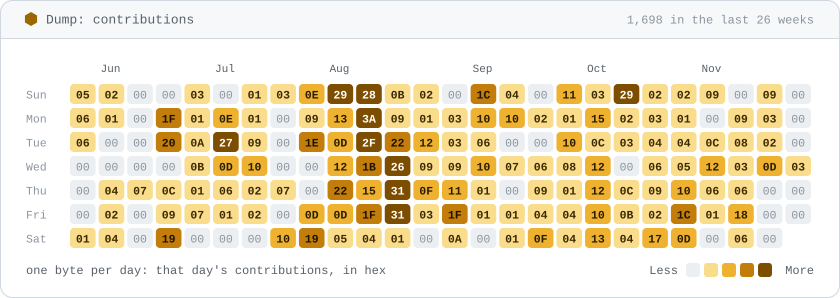

<picture>
  <source media="(prefers-color-scheme: dark)" srcset="assets/header-dark.svg">
  
</picture>

<picture>
  <source media="(prefers-color-scheme: dark)" srcset="assets/cpu-dark.svg">
  
</picture>

<picture>
  <source media="(prefers-color-scheme: dark)" srcset="assets/dump-dark.svg">
  
</picture>

These cards are drawn by <a href="scripts/generate.mjs">a small script</a> in this repository and redrawn every night by GitHub Actions.
